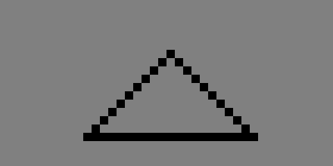
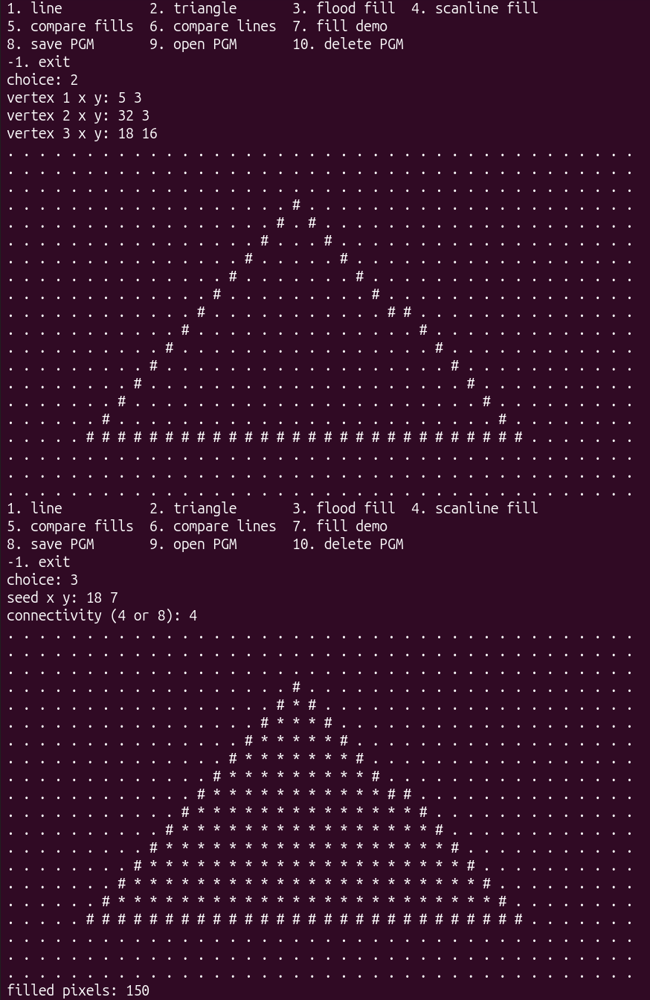
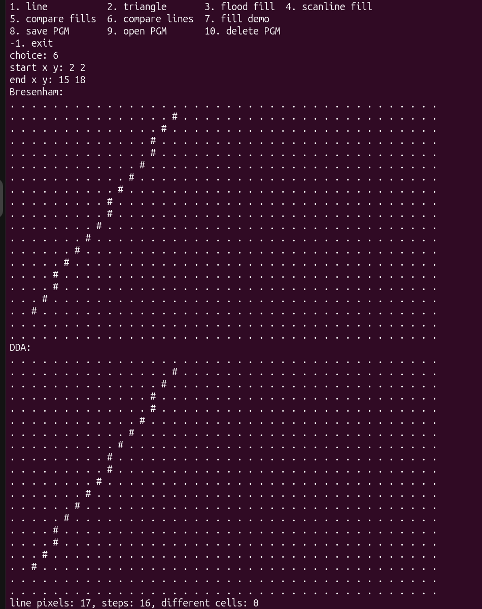
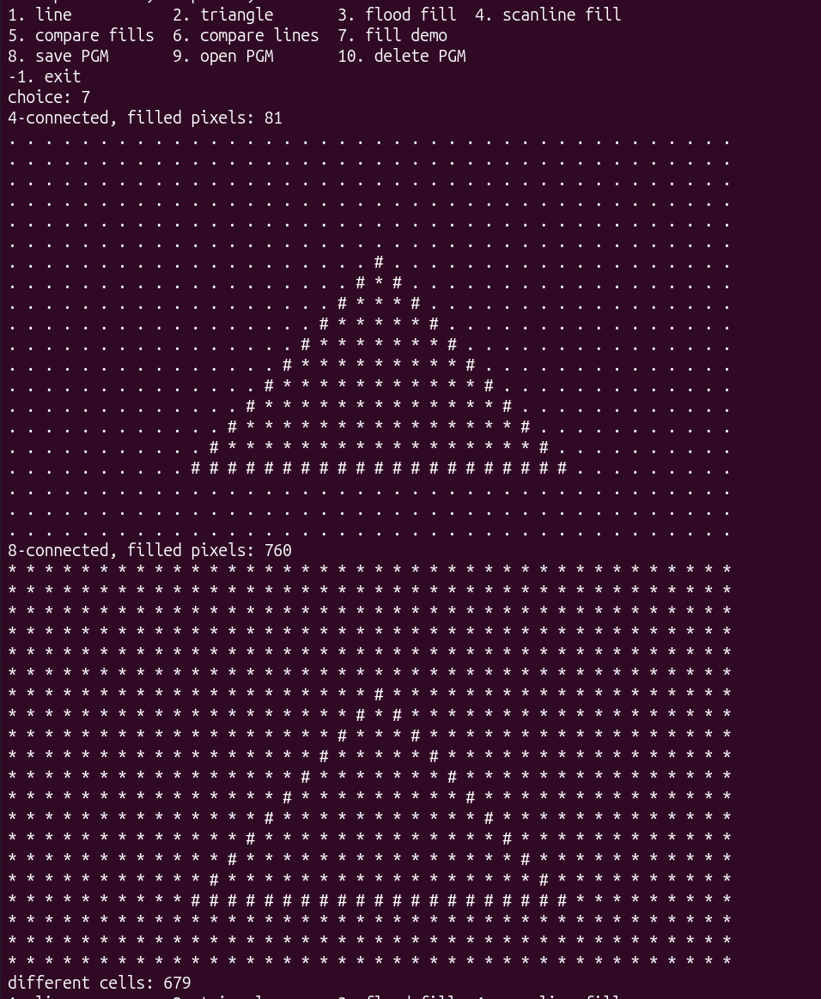

# Растеризация отрезков и заливка треугольника

## Задание

На сетке 40 × 20 нужно нарисовать отрезок по двум точкам алгоритмом Брезенхэма, построить треугольник по трём вершинам и залить его изнутри. Программа написана на C, координаты вводятся через меню в формате `x y`.

## Как это работает

**Алгоритм Брезенхэма.** Программа рисует отрезок по клеткам сетки, начиная с первой точки.

1. Сравнивает `|Δx|` и `|Δy|`, чтобы выбрать главную ось. Если `|Δx| ≥ |Δy|`, это ось X, иначе Y. Направление шага по каждой оси зависит от положения конечной точки.
2. На каждом шаге сдвигается на одну клетку по главной оси. Переменная `decision` помогает выбрать ближайший к линии пиксель. Если она отрицательная, шага по второй оси нет. Если она равна нулю или больше, программа делает ещё один шаг по второй оси.
3. После шага обновляет `decision` сложением и вычитанием целых чисел. Так продолжается до конечной точки. Например, для отрезка от (2, 2) до (30, 14) получается 28 шагов и 29 пикселей, считая начальную точку.

Тем же алгоритмом рисуются три стороны треугольника. Пункт `6` сравнивает результат с DDA, который вычисляет координаты с дробным шагом и округляет их.

- **Заливка с затравкой.** Пользователь задаёт точку внутри треугольника. Программа рекурсивно закрашивает соседние свободные клетки. При 4-связности учитываются только соседи по сторонам, при 8-связности ещё и по диагонали. На ступенчатой границе 8-связная заливка может выйти наружу. Разницу показывает пункт `7`.
- **Построчная заливка.** Для каждой строки программа находит два пересечения со сторонами треугольника и закрашивает свободные клетки между ними. Пункт `5` сравнивает её с 4-связной заливкой.

## Запуск

```bash
make run
```

`.` — пустая клетка, `#` — контур или отрезок, `*` — заливка. Пункт `8` сохраняет текущую сетку в `grid.pgm`, а `-1` завершает программу.

## Основные функции

| Функции | Что делают |
| --- | --- |
| `drawLine`, `drawDdaLine` | Рисуют отрезок алгоритмами Брезенхэма и DDA соответственно. |
| `drawTriangle`, `isTriangleValid`, `isPointInsideContour` | Рисуют контур и проверяют, что вершины образуют треугольник, а затравка лежит внутри. |
| `fillArea`, `fillScanline`, `showFillDemo` | Заливают область с затравкой или по строкам и показывают разницу между 4- и 8-связностью. |
| `clearGrid`, `copyGrid`, `printGrid`, `countDifferentCells` | Очищают, копируют, выводят и сравнивают сетки. |
| `readNumber`, `readPoint` | Читают целое число и координаты, проверяют ввод и границы сетки для точки. |
| `savePgm`, `OpenPgm`, `DeletePGM` | Сохраняют, открывают и удаляют файл `grid.pgm`. |
| `max` | Возвращает большее из двух чисел для подсчета количества шагов. |

### Обоснование выбора рекурсивной заливки

Для реализации Flood Fill используется рекурсивный обход в глубину (DFS). Каждый пиксель закрашивается перед обходом соседних пикселей, что исключает его повторную заливку и зацикливание алгоритма.

Размер растровой сетки ограничен условием лабораторной работы — 40 × 20 пикселей. Таким образом, максимальная глубина рекурсии не превышает 801 вызова с учётом завершающего вызова.

При таких размерах сетки рекурсивная реализация позволяет сохранить простоту и читаемость кода без необходимости организации явного стека.

При увеличении размеров сетки для предотвращения переполнения стека вызовов рекомендуется использовать итеративную реализацию с явным стеком в динамической памяти.

**Алгоритмическая сложность:**

- Временная — O(W × H).
- Пространственная — O(W × H) в худшем случае.

W — ширина сетки, H — высота сетки.

### Как сетка сохраняется в изображение

В пункте `8` функция `savePgm` записывает в `grid.pgm` заголовок `P2`, размер `40 × 20` и максимальную яркость `255`. `P2` обозначает текстовый формат PGM: яркость каждого пикселя записывается числом. Функция идёт по строкам сверху вниз и записывает `0` для чёрного (`#`), `128` для серого (`*`) и `255` для белого (`.`).



[grid-demo.pgm](grid-demo.pgm) — исходный файл изображения из примера с 8-связной заливкой.

## Скриншоты работы

### 1. Растеризация отрезка

Пункт `1`. `drawLine` строит отрезок от (2, 2) до (30, 14). На сетке получилось 29 пикселей за 28 шагов.


### 2. Треугольник и заливка с затравкой

Пункты `2` и `3`. `drawTriangle` строит контур по вершинам (5, 3), (32, 3) и (18, 16). `fillArea` заполняет его из точки (18, 7) по четырём направлениям. Закрашено 150 клеток.



### 3. Построчная заливка

Пункты `2` и `4`. `drawTriangle` строит тот же контур, а `fillScanline` закрашивает его по строкам. Получилось 150 закрашенных клеток.


### 4. Сравнение двух заливок

Пункт `5`. `fillArea` и `fillScanline` закрасили по 150 клеток. `countDifferentCells` сравнила две сетки и показала 0 различий.


### 5. Сравнение Брезенхэма и DDA

Пункт `6`. `drawLine` и `drawDdaLine` строят отрезок от (2, 2) до (15, 18). На этом примере получилось 17 пикселей за 16 шагов, и `countDifferentCells` показала 0 различий.



### 6. Сравнение 4- и 8-связной заливки

Пункт `7`. `showFillDemo` запускает `fillArea` с двумя вариантами связности. При 4-связности заливка осталась внутри треугольника и закрасила 81 клетку. При 8-связности она вышла за контур по диагонали и закрасила 760 клеток. Разница составила 679 клеток.


