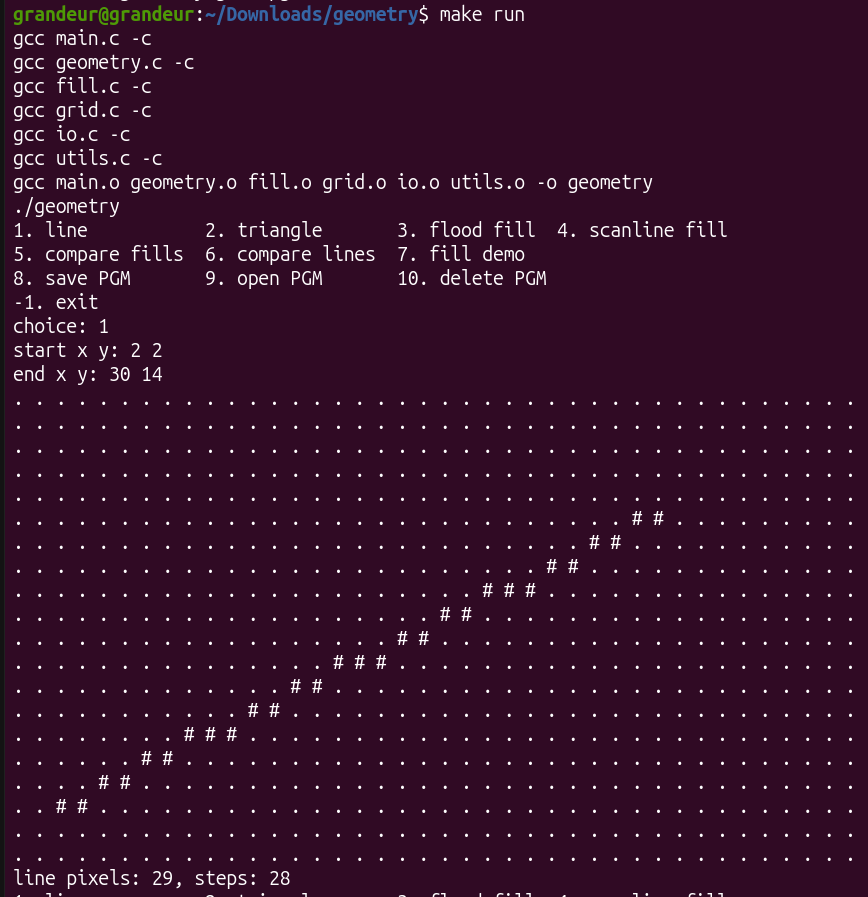
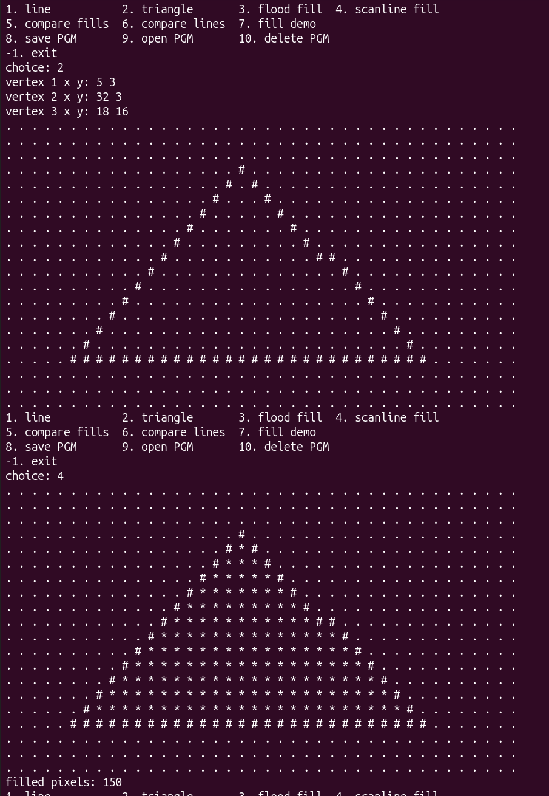
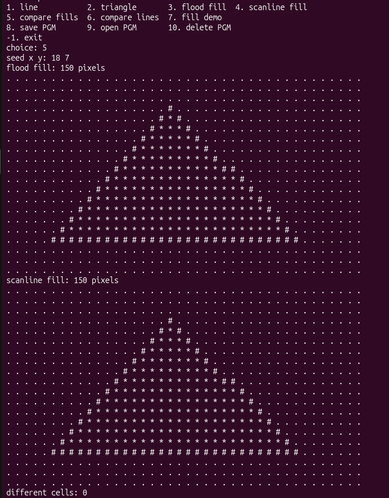

# Растеризация отрезков и заливка треугольника

## Задание

На сетке 40 × 20 нужно нарисовать отрезок по двум точкам алгоритмом Брезенхэма, построить треугольник по трём вершинам и залить его изнутри. Программа написана на C, координаты вводятся через меню в формате `x y`.

## Как это работает

**Алгоритм Брезенхэма.** Программа рисует отрезок по клеткам сетки, начиная с первой точки.

1. Сравнивает `|Δx|` и `|Δy|`, чтобы выбрать главную ось. Если `|Δx| ≥ |Δy|`, это ось X, иначе Y. Направление шага по каждой оси зависит от положения конечной точки.
2. На каждом шаге сдвигается на одну клетку по главной оси. Переменная `decision` помогает выбрать ближайший к линии пиксель. Если она отрицательная, шага по второй оси нет. Если она равна нулю или больше, программа делает ещё один шаг по второй оси.
3. После шага обновляет `decision` сложением и вычитанием целых чисел. Так продолжается до конечной точки. Например, для отрезка от (2, 2) до (30, 14) получается 28 шагов и 29 пикселей, считая начальную точку.

### Математическая основа алгоритма Брезенхэма

Для случая `0 ≤ Δy ≤ Δx` начальное значение параметра решения определяется формулой:

`decision = 2 * Δy - Δx`

Если `decision < 0`, выполняется шаг только по оси X:

`decision += 2 * Δy`

В противном случае выполняется шаг по обеим осям:

`decision += 2 * Δy - 2 * Δx`

Знак параметра решения позволяет определить, какой из двух соседних пикселей ближе к математическому отрезку.

Для остальных октантов учитываются абсолютные значения приращений координат, направления движения `stepX` и `stepY`, а также выбор главной оси.

Тем же алгоритмом рисуются три стороны треугольника. Пункт `6` сравнивает результат с DDA, который вычисляет координаты с дробным шагом и округляет их.

- **Заливка с затравкой.** Пользователь задаёт точку внутри треугольника. Программа рекурсивно закрашивает соседние свободные клетки. При 4-связности учитываются только соседи по сторонам, при 8-связности ещё и по диагонали. На ступенчатой границе 8-связная заливка может выйти наружу. Разницу показывает пункт `7`.
- **Построчная заливка.** Для каждой строки программа находит два пересечения со сторонами треугольника и закрашивает свободные клетки между ними. Пункт `5` сравнивает её с 4-связной заливкой.

### Проверка невырожденности треугольника

Для проверки корректности треугольника функция `isTriangleValid` вычисляет определитель двух векторов, построенных из его вершин:

`det = (x₁ - x₀) * (y₂ - y₀) - (y₁ - y₀) * (x₂ - x₀)`

Если определитель равен нулю, вершины лежат на одной прямой и треугольник является вырожденным.

Абсолютное значение определителя равно удвоенной площади треугольника.

При `det != 0` построение треугольника разрешается.

### Проверка принадлежности точки треугольнику

Функция `isPointInsideContour` определяет положение точки относительно каждой стороны треугольника с помощью знака векторного произведения.

Для стороны AB и проверяемой точки P вычисляется:

`crossProduct = (Bx - Ax) * (Py - Ay) - (By - Ay) * (Px - Ax)`

Если все три векторных произведения имеют одинаковый ненулевой знак, точка находится внутри треугольника.

Если знаки различаются, точка находится снаружи. Если хотя бы одно произведение равно нулю, точка лежит на прямой, содержащей сторону треугольника, и не принимается в качестве затравки.

Дополнительно проверяется принадлежность точки растровой сетке и отсутствие закрашенного пикселя в её координатах.

### Математическая основа построчной заливки

Для каждой строки с координатой Y вычисляются пересечения со сторонами треугольника по формуле:

`x = x₀ + (Y - y₀) * (x₁ - x₀) / (y₁ - y₀)`

Ребро учитывается только при выполнении условия:

`min(y₀, y₁) ≤ Y < max(y₀, y₁)`

Использование полуинтервала обеспечивает корректный учёт вершин и сохраняет чётность количества пересечений. Горизонтальные рёбра автоматически исключаются, что предотвращает деление на ноль.

После определения двух пересечений выбираются левая и правая границы. Закрашиваются только свободные пиксели, координаты которых строго находятся между этими границами.

### Алгоритм DDA

Количество шагов определяется по формуле:

`stepCount = max(|Δx|, |Δy|)`

Затем вычисляются приращения координат:

- `xStep = Δx / stepCount`
- `yStep = Δy / stepCount`

Координаты очередного пикселя определяются по формулам:

- `x = x₀ + i * xStep`
- `y = y₀ + i * yStep`

Полученные координаты округляются до ближайших целых чисел.

Если начальная и конечная точки совпадают, закрашивается один пиксель без вычисления приращений, что исключает деление на ноль.

В отличие от Брезенхэма, DDA использует вещественные вычисления. Результаты алгоритмов могут различаться из-за выбора пикселя в случаях, когда математический отрезок проходит на одинаковом расстоянии от двух соседних пикселей.

### Обработка некорректного ввода

Ввод осуществляется с помощью `fgets` с последующим разбором строки функцией `sscanf`.

Программа проверяет:

- соответствие ввода ожидаемому формату;
- отсутствие лишних символов;
- принадлежность координат диапазонам X ∈ [0; 39] и Y ∈ [0; 19];
- невырожденность треугольника;
- принадлежность затравки внутренней области треугольника;
- корректность выбора связности.

При обнаружении ошибки выводится соответствующее сообщение.

## Запуск

```bash
make run
```

`.` — пустая клетка, `#` — контур или отрезок, `*` — заливка. Пункт `8` сохраняет текущую сетку в `grid.pgm`, а `-1` завершает программу.

## Меню программы

Управление программой осуществляется через консольное меню. Для выполнения операции необходимо ввести соответствующий номер.

| Пункт | Назначение |
|---|---|
| `1` | Построение отрезка по двум точкам алгоритмом Брезенхэма. |
| `2` | Построение контура треугольника по трём вершинам. |
| `3` | Затравочная заливка треугольника с выбором 4- или 8-связности. |
| `4` | Построчная заливка треугольника (Scanline Fill). |
| `5` | Сравнение затравочной 4-связной и построчной заливок по количеству закрашенных и различающихся клеток. |
| `6` | Сравнение алгоритмов Брезенхэма и DDA. |
| `7` | Демонстрация различий между 4- и 8-связной заливкой. |
| `8` | Сохранение текущей растровой сетки в файл `grid.pgm`. |
| `9` | Открытие сохранённого изображения с помощью `xdg-open`. |
| `10` | Удаление файла `grid.pgm`. |
| `-1` | Завершение работы программы. |

Для выполнения пунктов `3`, `4` и `5` необходимо предварительно построить треугольник. Координаты вводятся в формате `x y`. После выполнения операции программа возвращается в главное меню.

## Основные функции

| Функции | Что делают |
| --- | --- |
| `drawLine`, `drawDdaLine` | Рисуют отрезок алгоритмами Брезенхэма и DDA соответственно. |
| `drawTriangle`, `isTriangleValid`, `isPointInsideContour` | Рисуют контур и проверяют, что вершины образуют треугольник, а затравка лежит внутри. |
| `fillArea`, `fillScanline`, `showFillDemo` | Заливают область с затравкой или по строкам и показывают разницу между 4- и 8-связностью. |
| `clearGrid`, `copyGrid`, `printGrid`, `countDifferentCells` | Очищают, копируют, выводят и сравнивают сетки. |
| `readNumber`, `readPoint` | Читают целое число и координаты, проверяют ввод и границы сетки для точки. |
| `savePgm`, `OpenPgm`, `DeletePGM` | Сохраняют, открывают и удаляют файл `grid.pgm`. |
| `max` | Возвращает большее из двух чисел для подсчета количества шагов. |

### Обоснование выбора рекурсивной заливки

Для реализации Flood Fill используется рекурсивный обход в глубину (DFS). Каждый пиксель закрашивается перед обходом соседних пикселей, что исключает его повторную заливку и зацикливание алгоритма.

Размер растровой сетки ограничен условием лабораторной работы — 40 × 20 пикселей. Таким образом, максимальная глубина рекурсии не превышает 801 вызова с учётом завершающего вызова.

При таких размерах сетки рекурсивная реализация позволяет сохранить простоту и читаемость кода без необходимости организации явного стека.

При увеличении размеров сетки для предотвращения переполнения стека вызовов рекомендуется использовать итеративную реализацию с явным стеком в динамической памяти.

**Алгоритмическая сложность:**

- Временная — O(W × H).
- Пространственная — O(W × H) в худшем случае.

W — ширина сетки, H — высота сетки.

### Как сетка сохраняется в изображение

В пункте `8` функция `savePgm` записывает в `grid.pgm` заголовок `P2`, размер `40 × 20` и максимальную яркость `255`. `P2` обозначает текстовый формат PGM: яркость каждого пикселя записывается числом. Функция обходит строки растровой сетки в порядке убывания координаты Y, поскольку в декартовой системе координат ось Y направлена вверх, а в формате PGM строки изображения записываются сверху вниз. Это позволяет сохранить правильную ориентацию изображения. Записывается `0` для чёрного (`#`), `128` для серого (`*`) и `255` для белого (`.`).

## Структура проекта

Программа разделена на отдельные файлы по функциональному назначению.

| Файл | Назначение |
| --- | --- |
| `main.c` | Главная функция программы, управление меню и вызов соответствующих алгоритмов. |
| `geometry.c` | Алгоритмы Брезенхэма и DDA, построение треугольника, проверка его невырожденности и принадлежности точки внутренней области. |
| `fill.c` | Рекурсивная затравочная заливка, построчная заливка и демонстрация различий между 4- и 8-связностью. |
| `grid.c` | Очистка, копирование, вывод и сравнение растровых сеток. |
| `io.c` | Ввод и проверка координат, сохранение, открытие и удаление PGM-файлов. |
| `utils.c` | Вспомогательная функция `max`. |
| `geometry.h` | Общий заголовочный файл, содержащий константы, структуру `point` и прототипы функций. |
| `Makefile` | Автоматизация раздельной компиляции, компоновки, запуска программы и удаления файлов сборки. |
| `README.md` | Описание проекта, алгоритмов и примеров работы программы. |
| `grid-demo.pgm` | Пример сохранённого растрового изображения. |
| `screenshots/` | Скриншоты результатов работы программы. |


Все исходные файлы используют общий заголовочный файл `geometry.h`. Каждый файл `.c` компилируется отдельно в объектный файл `.o`, после чего объектные файлы объединяются в исполняемый файл `geometry`.


[grid-demo.pgm](grid-demo.pgm) — исходный файл изображения из примера с 8-связной заливкой.

## Скриншоты работы

### 1. Растеризация отрезка

Пункт `1`. `drawLine` строит отрезок от (2, 2) до (30, 14). На сетке получилось 29 пикселей за 28 шагов.



### 2. Треугольник и заливка с затравкой

Пункты `2` и `3`. `drawTriangle` строит контур по вершинам (5, 3), (32, 3) и (18, 16). `fillArea` заполняет его из точки (18, 7) по четырём направлениям. Закрашено 150 клеток.


### 3. Построчная заливка

Пункты `2` и `4`. `drawTriangle` строит тот же контур, а `fillScanline` закрашивает его по строкам. Получилось 150 закрашенных клеток.



### 4. Сравнение двух заливок

Пункт `5`. `fillArea` и `fillScanline` закрасили по 150 клеток. `countDifferentCells` сравнила две сетки и показала 0 различий.



### 5. Сравнение Брезенхэма и DDA

Пункт `6`. `drawLine` и `drawDdaLine` строят отрезок от (2, 2) до (15, 18). На этом примере получилось 17 пикселей за 16 шагов, и `countDifferentCells` показала 0 различий.


### 6. Сравнение 4- и 8-связной заливки

Пункт `7`. `showFillDemo` запускает `fillArea` с двумя вариантами связности. При 4-связности заливка осталась внутри треугольника и закрасила 81 клетку. При 8-связности она вышла за контур по диагонали и закрасила 760 клеток. Разница составила 679 клеток.


